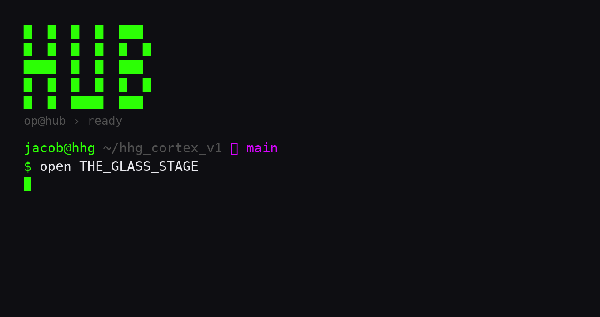
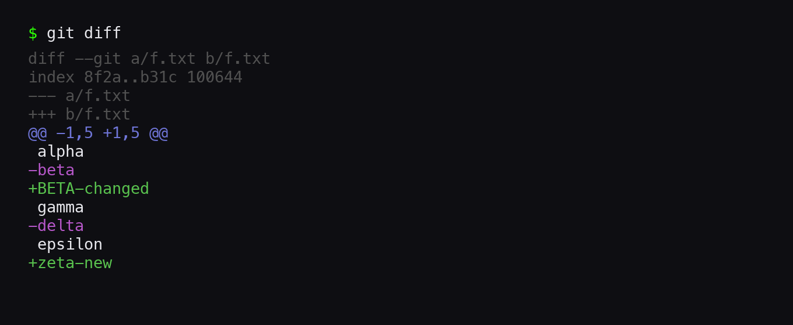

```
    █   █  █   █  ████
    █   █  █   █  █   █
    █   █  █   █  █   █
    █████  █   █  ████
    █   █  █   █  █   █
    █   █  █   █  █   █
    █   █   ███   ████
```

# THE GLASS STAGE

**An epoq terminal theme — one system across Ghostty, git, and Claude Code.**

The window is a glass stage (`#0E0E12`). Green is the one live signal allowed to
glow. There is **no red anywhere** — deletions, errors, and flags read as magenta,
so a `git diff` doesn't feel like an alarm. Free. Take it.

<p>


</p>

---

## The palette

| ink | hex | role |
|-----|-----|------|
| **signal-live** | `#2CFF05` | the live readout · cursor · additions · the pulse |
| **signal-flag** | `#D805FF` | the flag · error · removed-word |
| **flag-calm** | `#B657C9` | deletions · the calm magenta (the retuned "red") |
| **hum** | `#6F75D7` | the locator · hunk headers · warning |
| **dusk** | `#5F5295` | seen / faded · selection · prompt border |
| **grey-51** | `#515151` | dim · meta · comments |
| stage | `#0E0E12` | the glass stage (background) |
| paper | `#E8E8ED` | foreground |

Type is **[Red Hat Mono](https://fonts.google.com/specimen/Red+Hat+Mono)** — the specimen mono.

---

## Install

**Everything, guided (macOS):**
```sh
git clone https://github.com/lepetittruffier/glass-stage
cd glass-stage && ./install.sh
```
The installer backs up anything it touches (`*.bak.<date>`), and asks before each step.

**Or take only the parts you want:**

<details><summary><b>Ghostty</b></summary>

Copy [`ghostty/config`](ghostty/config) into `~/.config/ghostty/config`
(or merge the blocks you want). Reload with **⌘⇧,** or open a new window.
Requires Ghostty ≥ 1.2 (for `background-image`; the skin itself works on any version).
</details>

<details><summary><b>git — no-red diffs</b></summary>

```sh
sh git/glass-stage-colors.sh
```
Retunes `diff` / `status` / `log` colors globally: deletions magenta, additions
green, hunks hum-blue, meta dim. Reversible — the values live in `~/.gitconfig`.
</details>

<details><summary><b>Claude Code</b></summary>

Set `"theme": "dark-ansi"` in `~/.claude/settings.json` — Claude Code then follows
your terminal's palette (this one) instead of its brand colors. To pin exact epoq
inks (green thinking-pulse, non-red diffs), drop [`claude-code/themes/epoq.json`](claude-code/themes/epoq.json)
into `~/.claude/themes/` and set `"theme": "custom:epoq"`.
</details>

<details><summary><b>The HUB banner + palette specimen</b></summary>

`shell/hub-banner.sh` prints the HUB mark on new shells; `shell/palette-specimen.sh`
shows the full palette in truecolor. Wire the banner in `~/.zshrc`:
```sh
case "$TERM" in
  xterm-ghostty) [ -r "$HOME/.config/ghostty/hub-banner.sh" ] \
     && . "$HOME/.config/ghostty/hub-banner.sh" ;;
esac
```
</details>

**The font** (any OS): install *Red Hat Mono* from Google Fonts.
macOS via Homebrew: `brew install --cask font-red-hat-mono`.

---

## Live demo

The [`demo/`](demo/) folder is a self-contained page that renders the theme in the
browser — the terminal, the palette, the no-red diff, in Red Hat Mono. Deploy it to
GitHub Pages (Settings → Pages → `/demo`) or open `demo/index.html` directly.

---

## Why no red

Red is the default alarm of the terminal — and it's exhausting. THE GLASS STAGE
routes every "negative" signal (deletions, errors, flags) through **magenta**
instead: still distinct, still legible, never a jolt. One coherent palette, held
across every tool that colors your day.

## Credit & license

Designed on the **epoq** system by [Intelligence Matters](https://intelligencematters.se) / HHG.
MIT — see [LICENSE](LICENSE). Give it away, remix it, ship it.
